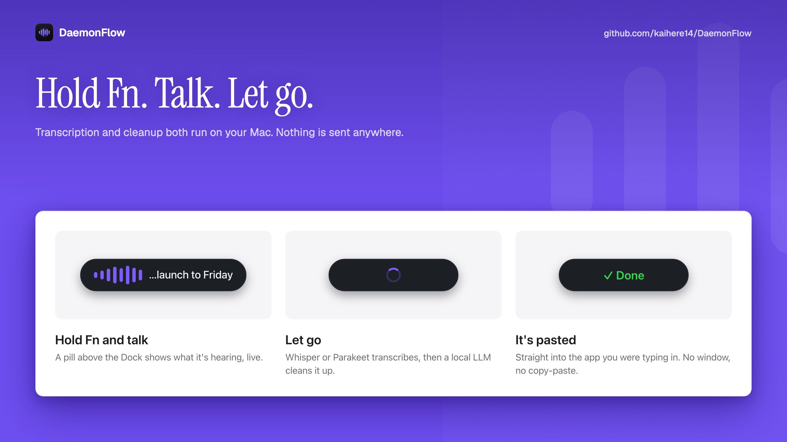
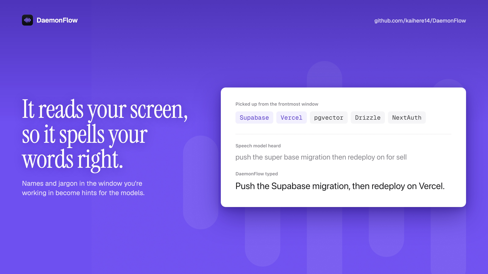
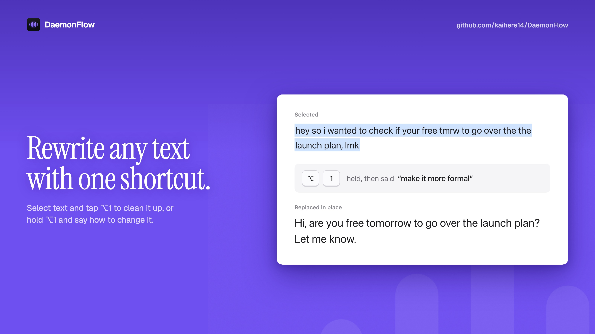
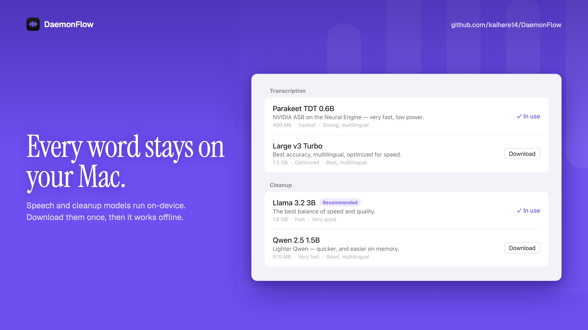

<div align="center">


# DaemonFlow

**Free, private voice dictation for macOS.** Hold **Fn**, speak, let go, and clean text lands in whatever app you were typing in.

DaemonFlow is an on-device alternative to Wispr Flow. It transcribes with Whisper or NVIDIA Parakeet, then a small local language model strips the ums, applies your self-corrections and fixes punctuation. Your voice and your text never leave your Mac.

[Download the latest release](https://github.com/kaihere14/DaemonFlow/releases/latest) · [Building from source](#building-from-source)

</div>

## Features

- **Dictate anywhere**: hold Fn to talk and release to paste into the frontmost app. Double-tap Fn for hands-free mode, and tap it again to stop.
- **Live preview**: a small pill above the Dock shows what it's hearing while you talk.
- **On-device transcription**: Whisper (Tiny to Large v3 Turbo) through whisper.cpp with Metal, or Parakeet TDT 0.6B v3 on the Neural Engine.
- **Local cleanup**: an MLX language model (Llama 3.2, Qwen 2.5, Phi 3.5 or Llama 3.1 8B) turns speech into written text: filler words removed, "Thursday, no wait, Friday" resolved to "Friday", and spoken lists formatted as lists.
- **Screen awareness**: names and jargon in the window you're working in become spelling hints, so "Supabase" on screen stops coming out as "super base".
- **Custom vocabulary**: add the spellings you keep fixing by hand, and anything close enough is rewritten to match.
- **⌥1 refine**: select text in any app and tap ⌥1 to clean it up in place. Hold ⌥1 and say how to change it ("make it more formal").
- **Editable prompts**: the instructions behind dictation cleanup, refine and instructed refine are yours to change.
- **Your pill, your way**: set the pill's size, colours and border.
- **History**: your last 200 dictations, raw and cleaned, stored on your Mac.



### Screen awareness

When you press Fn, DaemonFlow reads the text of the frontmost window through the Accessibility API and keeps only the unusual words: product names, identifiers and anything the macOS spell checker doesn't know. Those terms are passed to Whisper as a prompt and to the cleanup model as spelling references. Password fields are never read. Turn it off under **Vocabulary → Use text on screen**.



### ⌥1 refine



## Requirements

- macOS 27 or later
- Apple Silicon (the cleanup models run on MLX)

## Getting started

1. Download `DaemonFlow-macOS.zip` from [Releases](https://github.com/kaihere14/DaemonFlow/releases/latest), unzip it and drag DaemonFlow to Applications.
2. The app isn't notarized yet, so open it the first time with **right-click → Open → Open**, or run `xattr -cr /Applications/DaemonFlow.app` once.
3. Grant **Accessibility** (to paste and read the screen), **Input Monitoring** (for the Fn key) and **Microphone** when the setup asks.
4. Pick a transcription model and a cleanup model. Each downloads once, then works offline.
5. Click into a text field in any app, hold **Fn**, speak, and let go.

DaemonFlow lives in the menu bar, with no Dock icon.



## Privacy

- Transcription, cleanup and screen awareness all run on your Mac.
- Audio is kept in memory while you dictate and is never written to disk.
- Vocabulary and history live in `~/Library/Application Support/DaemonFlow/` (`vocabulary.json`, `transcripts.json`), not encrypted.
- Whisper models live in `DaemonFlow/Models` and cleanup models in `DaemonFlow/MLXModels` next to them. Parakeet is stored by FluidAudio in `~/Library/Application Support/FluidAudio/Models`.
- The only network access is downloading models, from Hugging Face, when you choose one.

## Troubleshooting

- **Fn or paste stopped working after an update**: DaemonFlow isn't signed with a developer certificate yet, so macOS treats each new build as a different app. Remove DaemonFlow from System Settings → Privacy & Security → **Accessibility** and **Input Monitoring**, then add it again.
- **"DaemonFlow can't be opened"**: see step 2 of Getting started.
- **First dictation is slow**: the models load into memory on first use, and stay loaded after that.

## Building from source

Requires Xcode with the macOS 27 SDK and `cmake`.

```sh
git clone --recurse-submodules https://github.com/kaihere14/DaemonFlow.git
cd DaemonFlow
./scripts/build-whisper.sh        # builds whisper.cpp static libs
./scripts/build-and-install.sh    # Release build → /Applications/DaemonFlow.app
```
